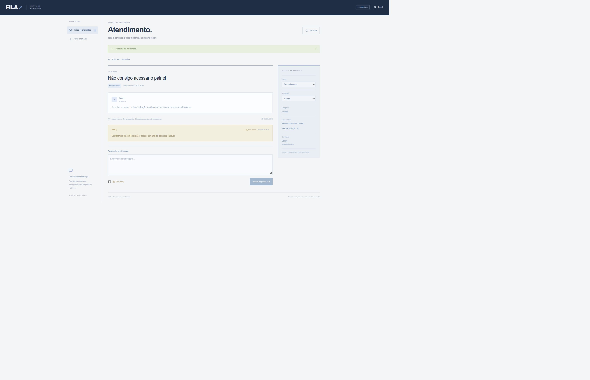

# Fila — Central de chamados

Atendimento com dois perfis: cliente abre e acompanha as próprias solicitações; o responsável gerencia a fila, responde, registra notas internas e altera a triagem. Todo atendimento mantém uma trilha de eventos e usa versão para evitar que alterações concorrentes se sobrescrevam.

## Demonstração no GitHub Pages

[Abrir demonstração interativa](https://mateusmarques2026.github.io/fila-chamados/)

A demonstração usa as mesmas interfaces do projeto com um adaptador exclusivo em demo/. Os dados são fictícios, ficam no armazenamento local do navegador e podem ser reiniciados pelo botão no topo. A troca de visão simula os papéis para apresentação; não é autenticação nem controle de acesso real. Não use dados pessoais nesta demonstração. A versão completa com servidor, identidade e SQL permanece no restante do projeto.

Para executar: npm ci, npm run demo:build e npm run demo:dev. O comando demo:build gera dist-demo/; o workflow pages.yml publica essa pasta. Em Settings → Pages, a origem é GitHub Actions.

## Funcionalidades

- Abrir chamado com título, descrição, categoria e prioridade.
- Lista pesquisável com filtros de status e indicadores.
- Cliente acessa somente os próprios chamados.
- Responsável visualiza a fila completa e assume o atendimento.
- Conversa com mensagens públicas e notas internas protegidas no servidor.
- Histórico de criação, respostas, atribuição, prioridade e status.
- Fluxo de estados: novo, em andamento, aguardando cliente, resolvido e cancelado.
- Resposta do cliente em um chamado que aguarda retorno volta o atendimento para em andamento.
- Reabertura de chamados resolvidos pelo responsável.
- Controle de versão: solicitações concorrentes recebem 200/409, sem evento órfão.
- Interface responsiva e exemplos fictícios carregados por ação explícita.

## Executar

Requisitos: Node.js 24, npm e Git.

~~~sh
npm ci
npm run build
npm run db:migrate:local
npm run dev -- --port 5176
~~~

Abra http://localhost:5176. O login local usa uma conta fictícia de responsável. A versão hospedada usa a identidade do Sites e começa privada. Não há cadastro público de administradores nem autenticação própria por senha.

## Responsável e permissões

Defina DESK_ADMIN_EMAIL nas variáveis de runtime do Sites com o e-mail do responsável e publique uma versão. O servidor vincula essa conta ao workspace na primeira entrada autorizada. Trocar somente a variável não transfere o workspace para outro ID.

Demais identidades autenticadas são clientes. O ID do solicitante e o autor dos eventos vêm da sessão, nunca de um campo enviado pelo navegador. Os endpoints de consulta incluem a condição de propriedade. Notas internas são filtradas pelo servidor, não apenas escondidas na interface.

A demonstração privada exige também permissão de acesso ao Site. Publicar o repositório no GitHub não libera acesso à demonstração nem às informações dos chamados.

## Testar

~~~sh
npm test
npm run typecheck
npm run build
~~~

Para os testes HTTP, inicie npm run dev:roles -- --port 5176 em outro terminal e rode npm run test:integration. Use FILA_TEST_URL para outra URL de loopback.

O modo dev:roles ativa identidades fictícias locais (Alice e Bruno) depois do login de desenvolvimento. Esse middleware exige loopback e não é incluído no Worker de produção. A integração escreve chamados fictícios no banco local.

## Concorrência e auditoria

Cada chamado tem um número de versão. Alterações e respostas enviam a versão que a interface conhece. Um UPDATE condicionado à versão incrementa o valor e guarda um identificador de mutação gerado pelo servidor.

A atualização e os eventos são gravados em um batch atômico. Os INSERTs de eventos só executam quando o chamado contém o identificador daquela mutação. Se duas requisições disputarem a mesma versão, somente uma altera o chamado; a outra recebe 409 e não gera histórico falso.

Ao detectar conflito, a interface recarrega os detalhes e mantém a resposta digitada para nova revisão. Resolver ou cancelar bloqueia mensagens; chamados resolvidos podem voltar para em andamento, enquanto cancelado é terminal.

## API

| Método | Rota | Ação |
| --- | --- | --- |
| GET | /api/session | Perfil conectado |
| GET | /api/tickets?status=&q= | Lista autorizada e indicadores |
| POST | /api/tickets | Abrir chamado da própria conta |
| GET | /api/tickets/:id | Detalhes e eventos autorizados |
| PATCH | /api/tickets/:id | Triagem pelo responsável |
| POST | /api/tickets/:id/replies | Resposta pública ou nota interna |

## Estrutura

~~~text
app/desk.tsx                  Fila, formulário e conversa
app/api/[...path]/route.ts     API autenticada
lib/desk.ts                   Autorização, persistência e mutações
lib/ticket-rules.ts            Estados e transições válidas
db/schema.ts                  Workspace, chamados e eventos
drizzle/                      Migração incremental
tests/                        Regras e integração entre contas
~~~

## Tecnologias e limites

React, TypeScript, Vinext/Vite, Cloudflare Workers, D1/SQLite, Drizzle e Zod, a partir do starter do Sites. Um workspace e um responsável nesta versão. Até 200 chamados por consulta. Não inclui anexos, notificações por e-mail ou integração com IA; múltiplos atendentes, paginação e avaliações de sugestões automáticas são próximos incrementos.

O código teve assistência de IA. Para uma entrevista, pratique explicar autorização, notas internas, máquina de estados, versão otimista e gravação atômica dos eventos.
